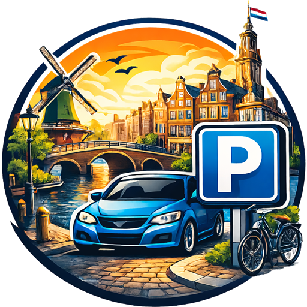

<h1 align="center">
  
   
  City Visitor Parking
   
  Beheer bezoekersparkeren in Home Assistant
</h1>

  Deze integratie is gratis en open source. Bespaart het je een bezoek aan het parkeerportaal, dan wordt een biertje zeer gewaardeerd! 🍺

  

  

<!-- ha-marketplace:exclude-start -->

  

> [!TIP]
> Op zoek naar Engelstalige documentatie? Zie de [Engelse README](README.md) of de [wiki](https://github.com/sir-Unknown/ha_City-Visitor-Parking/wiki)

<!-- ha-marketplace:exclude-end -->

## Over deze integratie

Met **City Visitor Parking** beheer je bezoekersparkeervergunningen van ondersteunde Nederlandse gemeenten rechtstreeks vanuit Home Assistant.

Met deze integratie kun je:

- een parkeersessie starten, wijzigen en stoppen
- snel een opgeslagen kenteken kiezen
- direct zien of parkeren betaald of gratis is
- bezoekersparkeren automatiseren met Home Assistant-automatiseringen en -scripts

Zo hoef je niet elke keer handmatig in te loggen op het parkeerportaal van de gemeente.

---

## Belangrijk

> [!IMPORTANT]
> Deze integratie wordt actief ontwikkeld. Daardoor kunnen functies af en toe niet goed werken en kunnen nieuwe versies fouten introduceren.
>
> Controleer altijd in het officiële parkeerportaal dat een sessie correct is gestart, gewijzigd of gestopt.
>
> De beheerder en bijdragers kunnen niet aansprakelijk worden gesteld voor onjuist geregistreerde parkeersessies of eventuele boetes die daaruit voortvloeien.
>
> Deze integratie is grotendeels ontwikkeld met hulp van AI-agents, voornamelijk ChatGPT en Claude.

---

## Schermafbeeldingen

Meer schermafbeeldingen: [wiki/en/Lovelace-Cards](https://github.com/sir-Unknown/ha_City-Visitor-Parking/wiki/lovelace-cards)

---

## Ondersteunde gemeenten

De integratie ondersteunt een groeiend aantal Nederlandse gemeenten en maakt verbinding met hun bezoekersparkeersystemen.

<strong>Toon ondersteunde gemeenten</strong>

| Gemeente         | Portaal                                                                                 |
| ---------------- | --------------------------------------------------------------------------------------- |
| Amstelveen       | [mijn.2park.nl](https://mijn.2park.nl/)                                                 |
| Nijmegen         | [parkeerproducten.nijmegen.nl](https://parkeerproducten.nijmegen.nl/DVSPortal/)         |
| Apeldoorn        | [parkeren.apeldoorn.nl](https://parkeren.apeldoorn.nl/DVSPortal/)                       |
| Nissewaard       | [parkeren.nissewaard.nl](https://parkeren.nissewaard.nl/DVSPortal/)                     |
| Assen            | [mijn.2park.nl](https://mijn.2park.nl/)                                                 |
| Oldenzaal        | [parkeren.oldenzaal.nl](https://parkeren.oldenzaal.nl/DVSPortal/)                       |
| Bergen op Zoom   | [mijn.2park.nl](https://mijn.2park.nl/)                                                 |
| Oosterhout       | [mijn.2park.nl](https://mijn.2park.nl/)                                                 |
| Bloemendaal      | [parkeren.bloemendaal.nl](https://parkeren.bloemendaal.nl/DVSPortal/)                   |
| Oss              | [mijn.2park.nl](https://mijn.2park.nl/)                                                 |
| Breda            | [mijn.2park.nl](https://mijn.2park.nl/)                                                 |
| Rijswijk         | [parkeren.rijswijk.nl](https://parkeren.rijswijk.nl/DVSPortal/)                         |
| Delft            | [vergunningen.parkerendelft.com](https://vergunningen.parkerendelft.com/DVSPortal/)     |
| Roermond         | [parkeren.roermond.nl](https://parkeren.roermond.nl/DVSPortal/)                         |
| Den Haag         | [parkerendenhaag.denhaag.nl](https://parkerendenhaag.denhaag.nl/)                       |
| Roosendaal       | [mijn.2park.nl](https://mijn.2park.nl/)                                                 |
| Deventer         | [mijn.2park.nl](https://mijn.2park.nl/)                                                 |
| Sittard-Geleen   | [parkeren.sittard-geleen.nl](https://parkeren.sittard-geleen.nl/DVSPortal/)             |
| Doetinchem       | [parkeren.buha.nl](https://parkeren.buha.nl/DVSPortal/)                                 |
| Sluis            | [mijn.2park.nl](https://mijn.2park.nl/)                                                 |
| Dordrecht        | [mijn.2park.nl](https://mijn.2park.nl/)                                                 |
| Smallingerland   | [parkeren.smallingerland.nl](https://parkeren.smallingerland.nl/DVSPortal/)             |
| Eindhoven        | [mijn.2park.nl](https://mijn.2park.nl/)                                                 |
| Súdwest-Fryslân  | [parkeren.sudwestfryslan.nl](https://parkeren.sudwestfryslan.nl/DVSPortal/)             |
| Emmen            | [mijn.2park.nl](https://mijn.2park.nl/)                                                 |
| Terneuzen        | [mijn.2park.nl](https://mijn.2park.nl/)                                                 |
| Etten-Leur       | [mijn.2park.nl](https://mijn.2park.nl/)                                                 |
| Tiel             | [mijn.2park.nl](https://mijn.2park.nl/)                                                 |
| Gorinchem        | [mijn.2park.nl](https://mijn.2park.nl/)                                                 |
| Veenendaal       | [mijn.2park.nl](https://mijn.2park.nl/)                                                 |
| Groningen        | [aanvraagparkeren.groningen.nl](https://aanvraagparkeren.groningen.nl/DVSPortal/)       |
| Veere            | [parkeren.veere.nl](https://parkeren.veere.nl/DVSPortal/)                               |
| Haarlem          | [parkeren.haarlem.nl](https://parkeren.haarlem.nl/DVSPortal/)                           |
| Venlo            | [parkeren.venlo.nl](https://parkeren.venlo.nl/DVSPortal/)                               |
| Hardenberg       | [mijn.2park.nl](https://mijn.2park.nl/)                                                 |
| Vlaardingen      | [mijn.2park.nl](https://mijn.2park.nl/)                                                 |
| Harderwijk       | [mijn.2park.nl](https://mijn.2park.nl/)                                                 |
| Vlissingen       | [parkeren.vlissingen.nl](https://parkeren.vlissingen.nl/DVSPortal/)                     |
| Harlingen        | [parkeervergunningen.harlingen.nl](https://parkeervergunningen.harlingen.nl/DVSPortal/) |
| Hoorn            | [parkeren.hoorn.nl](https://parkeren.hoorn.nl/DVSPortal/)                               |
| Waadhoeke        | [parkeren.waadhoeke.nl](https://parkeren.waadhoeke.nl/DVSPortal/)                       |
| Heemstede        | [parkeren.heemstede.nl](https://parkeren.heemstede.nl/DVSPortal/)                       |
| Waalwijk         | [parkeren.waalwijk.nl](https://parkeren.waalwijk.nl/DVSPortal/)                         |
| Heerenveen       | [parkeren.heerenveen.nl](https://parkeren.heerenveen.nl/DVSPortal/)                     |
| Weert            | [parkeerloket.weert.nl](https://parkeerloket.weert.nl/DVSPortal/)                       |
| Heerlen          | [parkeren.heerlen.nl](https://parkeren.heerlen.nl/DVSPortal/)                           |
| Zaanstad         | [parkeren.zaanstad.nl](https://parkeren.zaanstad.nl/DVSPortal/)                         |
| Hengelo          | [parkeren.hengelo.nl](https://parkeren.hengelo.nl/DVSPortal/)                           |
| Zevenaar         | [parkeren.zevenaar.nl](https://parkeren.zevenaar.nl/DVSPortal/)                         |
| 's-Hertogenbosch | [parkeren.s-hertogenbosch.nl](https://parkeren.s-hertogenbosch.nl/DVSPortal/)           |
| Zutphen          | [parkeren.zutphen.nl](https://parkeren.zutphen.nl/DVSPortal/)                           |
| Katwijk          | [parkeren.katwijk.nl](https://parkeren.katwijk.nl/DVSPortal/)                           |
| Zwolle           | [parkeerloket.zwolle.nl](https://parkeerloket.zwolle.nl/DVSPortal/)                     |
| Leiden           | [parkeren.leiden.nl](https://parkeren.leiden.nl/DVSPortal/)                             |
| Maastricht       | [mijn.2park.nl](https://mijn.2park.nl/)                                                 |
| Middelburg       | [parkeren.middelburg.nl](https://parkeren.middelburg.nl/DVSPortal/)                     |

---

## Ontbreekt jouw gemeente?

Staat jouw gemeente er nog niet bij, dan kun je ondersteuning aanvragen via GitHub Issues:

- [Ondersteuning aanvragen](https://github.com/sir-Unknown/ha_City-Visitor-Parking/issues/new)

Ondersteuning voor een nieuwe gemeente toevoegen vraagt nauwe samenwerking. Mogelijk word je gevraagd om:

- diagnostische logging aan te leveren
- tijdelijk toegang te geven tot je account op het parkeerportaal voor onderzoek

Meer informatie:

- [Add municipalities (EN)](https://github.com/sir-Unknown/ha_City-Visitor-Parking/wiki/add-municipalities)
- [Gemeenten toevoegen (NL)](https://github.com/sir-Unknown/ha_City-Visitor-Parking/wiki/gemeenten-toevoegen)

---

## Documentatie

### Nederlands

- [Home](https://github.com/sir-Unknown/ha_City-Visitor-Parking/wiki/Home)
<!-- ha-marketplace:exclude-start -->
- [Installatie](https://github.com/sir-Unknown/ha_City-Visitor-Parking/wiki/Installatie)
<!-- ha-marketplace:exclude-end -->
- [Configuratie](https://github.com/sir-Unknown/ha_City-Visitor-Parking/wiki/Configuratie)
- [Diensten](https://github.com/sir-Unknown/ha_City-Visitor-Parking/wiki/Diensten)
- [Probleemoplossing](https://github.com/sir-Unknown/ha_City-Visitor-Parking/wiki/Probleemoplossing)
- [Voorbeelden](https://github.com/sir-Unknown/ha_City-Visitor-Parking/wiki/Voorbeelden)

### English

- [Home](https://github.com/sir-Unknown/ha_City-Visitor-Parking/wiki/Home)
<!-- ha-marketplace:exclude-start -->
- [Installation](https://github.com/sir-Unknown/ha_City-Visitor-Parking/wiki/Installation)
<!-- ha-marketplace:exclude-end -->
- [Configuration](https://github.com/sir-Unknown/ha_City-Visitor-Parking/wiki/Configuration)
- [Lovelace Cards](https://github.com/sir-Unknown/ha_City-Visitor-Parking/wiki/Lovelace-Cards)
- [Services](https://github.com/sir-Unknown/ha_City-Visitor-Parking/wiki/Services)
- [Blueprints](https://github.com/sir-Unknown/ha_City-Visitor-Parking/wiki/Blueprints)
- [Troubleshooting](https://github.com/sir-Unknown/ha_City-Visitor-Parking/wiki/Troubleshooting)
- [Privacy](https://github.com/sir-Unknown/ha_City-Visitor-Parking/wiki/Privacy)
- [Examples](https://github.com/sir-Unknown/ha_City-Visitor-Parking/wiki/Examples)

### Bibliotheek

- [pyCityVisitorParking](https://github.com/sir-Unknown/pyCityVisitorParking)
- [README](https://github.com/sir-Unknown/pyCityVisitorParking#readme)
- [PyPI: pycityvisitorparking](https://pypi.org/project/pycityvisitorparking/)
